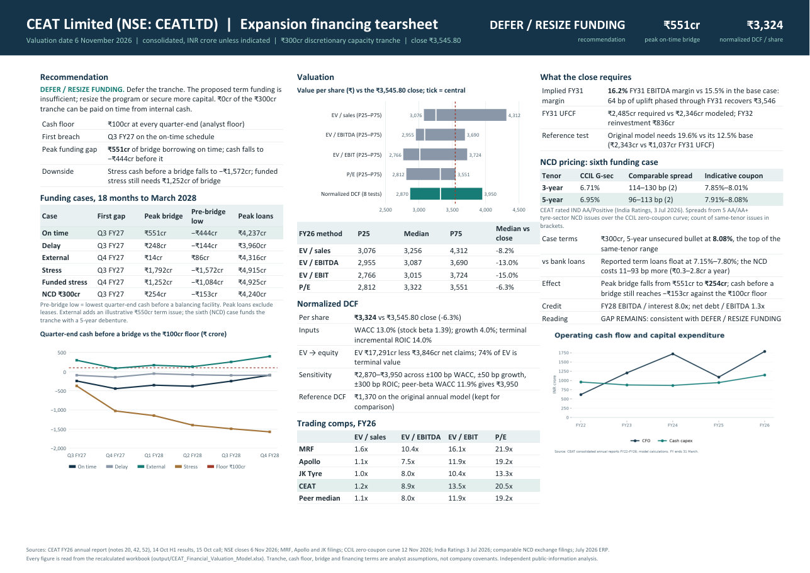
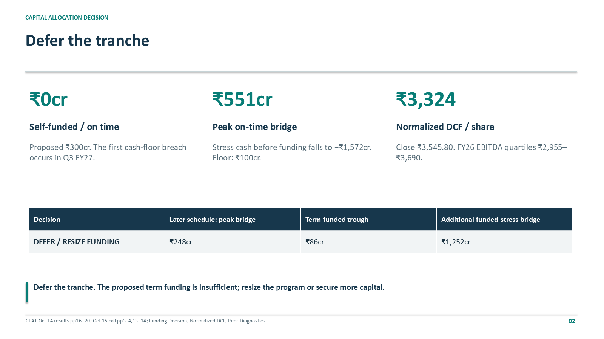
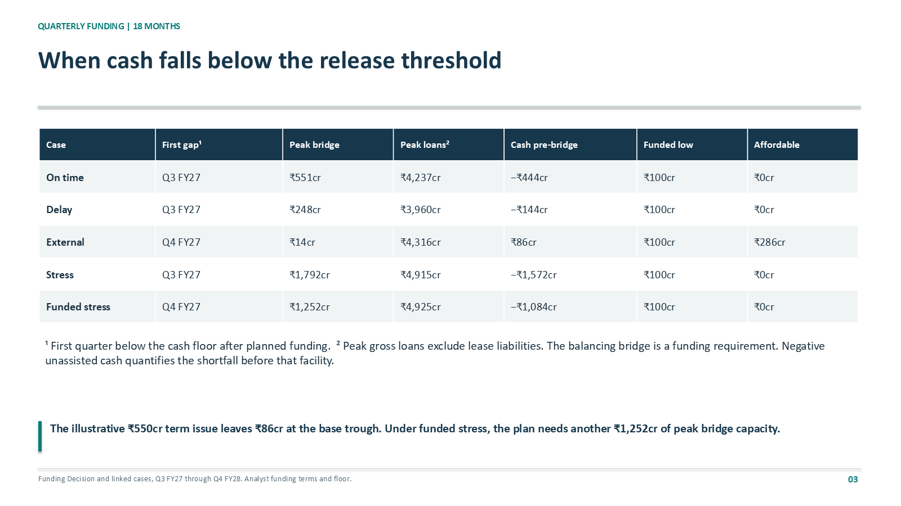
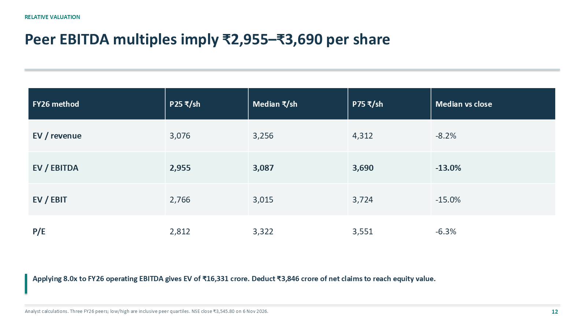
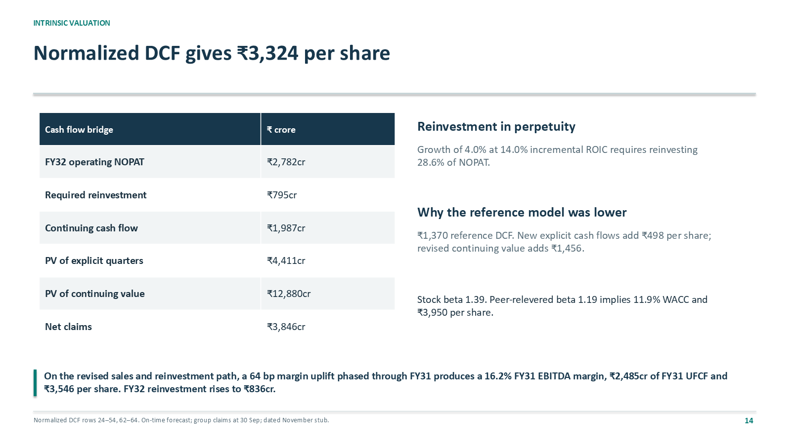
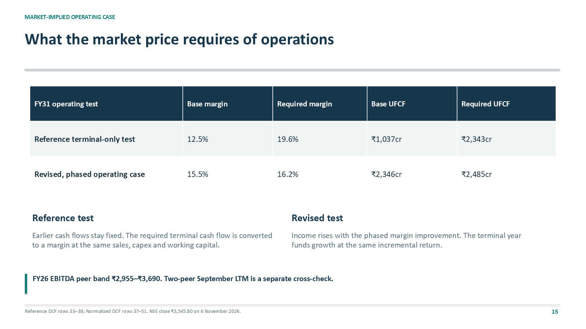
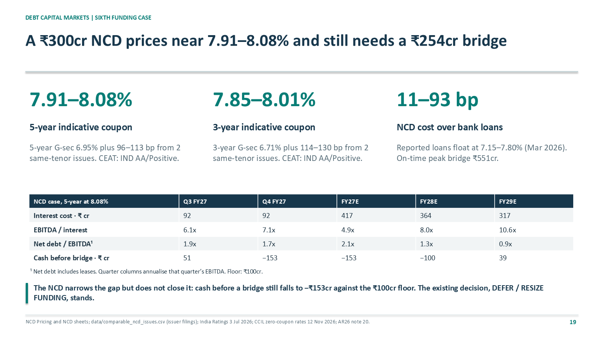
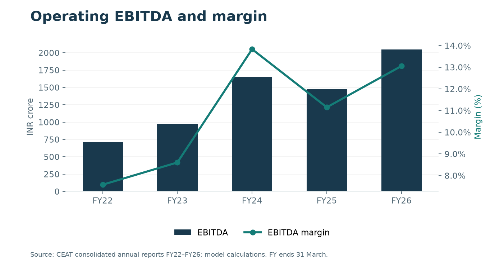
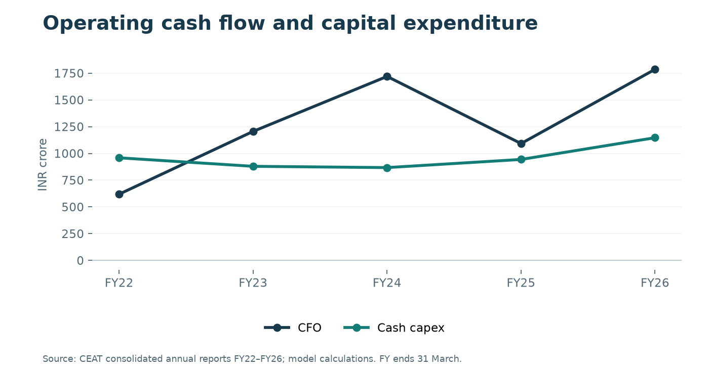

# CEAT Limited | Expansion financing and valuation

[](https://github.com/KartikPawar1411/CEAT-Investment-Banking-Project/actions/workflows/tests.yml)


**Can CEAT Limited (NSE: CEATLTD) pay for a ₹300cr capacity tranche on schedule without breaking its cash floor? A quarterly three-statement model built from CEAT's filings says no.**

**Result: DEFER / RESIZE FUNDING.** Defer the tranche. The proposed term funding is insufficient; resize the program or secure more capital.
- **₹0cr of the ₹300cr tranche** can be paid on time from internal cash. The on-time schedule first breaches the ₹100cr cash floor in **Q3 FY27** and needs **₹551cr** of peak bridge borrowing.
- A ₹300cr five-year NCD prices at an indicative **7.91–8.08%**. It cuts the peak bridge to ₹254cr but does not close the gap.
- The normalized DCF gives **₹3,324 per share** against the ₹3,545.80 close. The close requires a **16.2% FY31 EBITDA margin**, against 15.5% in the base case.

[](output/CEAT_Deal_Tearsheet.pdf)
<sub>One-page deal tearsheet. Click it for the PDF.</sub>

| Open | What it is |
|---|---|
| [**Tearsheet**](output/CEAT_Deal_Tearsheet.pdf) | One landscape page: recommendation, six funding cases, cash path, valuation range, implied margin, NCD pricing |
| [**Investment brief**](output/CEAT_Valuation_Summary.pdf) | One A4 page for the investment committee: the decision argued in prose, five funding cases, release conditions |
| [**Excel model**](output/CEAT_Financial_Valuation_Model.xlsx) | 32 sheets, every output a live formula. Start at Cover & Dashboard, then Funding Decision; edit the blue cells in Funding Inputs |
| [**Pitch book**](output/CEAT_Investment_Banking_Pitch_Book.pptx) ([PDF](output/CEAT_Investment_Banking_Pitch_Book.pdf)) | 19 slides. Slides 2–3: decision and capital requirement. Slides 13–15: operating case vs the market. Slide 19: NCD case |
| [**Research report**](reports/CEAT_Investment_Banking_Research_Report.md) | Company and sector evidence, forecast economics, peer and intrinsic valuation, risks and references |
| [**NCD funding case**](docs/ncd_case.md) | Sixth funding case: a five-year NCD for the ₹300cr tranche, priced from 5 AA/AA+ tyre-sector issues |
| [**Input lineage**](data/processed/input_register.csv) · [**sources**](data/sources.csv) | 660 inputs traced to filing, page, reporting unit and conversion; 82 dated sources |
| [**Validation**](reports/validation.md) · [**threshold test**](reports/decision_threshold_test.csv) | Independent checks, and a separately recalculated decision at a different tranche size |

## The decision in 30 seconds

| | |
|---|---:|
| Proposed tranche / self-funded on schedule | ₹300cr / **₹0cr** |
| Cash floor / first quarter below it | ₹100cr / Q3 FY27 |
| Peak bridge: on time / delayed / funded stress | **₹551cr** / ₹248cr / ₹1,252cr |
| Cash before a bridge, lowest quarter: on time / stress | −₹444cr / −₹1,572cr |
| Illustrative ₹550cr term issue: lowest quarter-end cash | ₹86cr |
| NCD case: coupon / peak bridge | 8.08% / ₹254cr |
| Normalized DCF vs close | **₹3,324** vs ₹3,545.80 (-6.3%) |
| DCF sensitivity range (8 tests) | ₹2,870–₹3,950 |
| FY26 peer EV/EBITDA, P25–P75 per share | ₹2,955–₹3,690 (median 8.0x) |
| FY31 EBITDA margin: base / implied by the close | 15.5% / **16.2%** |
| WACC / perpetual growth / terminal ROIC | 13.0% / 4.0% / 14.0% |

## What the numbers show

1. **The plan is not self-funding on schedule.** Cash before any bridge falls to −₹444cr on the on-time schedule. In stress it falls to −₹1,572cr. ₹0cr of the ₹300cr tranche can be paid on its dates while holding the ₹100cr floor.
2. **Delay alone does not fix it.** Moving the two payments back four quarters cuts the peak bridge to ₹248cr, but the core plan still breaches the floor in Q3 FY27.
3. **Debt narrows the gap but does not close it.** The illustrative ₹550cr term issue leaves ₹86cr at the base trough. Under funded stress, the plan needs another ₹1,252cr of peak bridge capacity. The NCD case cuts the peak bridge from ₹551cr to ₹254cr. Cash before a bridge still reaches −₹153cr, so the decision stands.
4. **The market is pricing a better margin than the base case.** The DCF sits 6.3% below the close. Recovering the close needs 64 bp of extra FY31 EBITDA margin, phased in, on the same sales and reinvestment path.



<details>
<summary><b>Funding cases, valuation, market-implied margin, NCD case and history</b></summary>









</details>

## Capital decision

| Case | First gap¹ | Peak bridge | Peak loans² | Cash pre-bridge | Funded low | Affordable |
| --- | --- | --- | --- | --- | --- | --- |
| On time | Q3 FY27 | ₹551cr | ₹4,237cr | −₹444cr | ₹100cr | ₹0cr |
| Delay | Q3 FY27 | ₹248cr | ₹3,960cr | −₹144cr | ₹100cr | ₹0cr |
| External | Q4 FY27 | ₹14cr | ₹4,316cr | ₹86cr | ₹100cr | ₹286cr |
| Stress | Q3 FY27 | ₹1,792cr | ₹4,915cr | −₹1,572cr | ₹100cr | ₹0cr |
| Funded stress | Q4 FY27 | ₹1,252cr | ₹4,925cr | −₹1,084cr | ₹100cr | ₹0cr |

First gap is the first modeled quarter-end below the ₹100cr analyst floor after any planned issuance. Peak loans exclude lease liabilities. Affordable is the portion of the proposed tranche that can be paid on its specified schedule while preserving the floor through March 2028. A balancing facility covers deficits in the integrated statements; its availability is unverified. View the unassisted cash path alongside financed cash. September opens at ₹32cr and intra-quarter liquidity is unknown.

FY27 standalone capex guidance was ₹1,400cr plus ₹100–150cr for CAMSO upstream equipment. The midpoint leaves ₹723cr of core spending in H2 after ₹802cr in H1. The proposed tranche is incremental. FY26 note 42 reported ₹1,785.12cr of March capital contracts. The September contracted balance and payment schedule are unknown. The core expansion bucket is an analyst planning allocation. The model includes the separate US$44m trademark in Q2 FY29. Inventory timing remains a working-capital risk.

## Valuation

The normalized DCF gives ₹3,324 per share versus the ₹3,545.80 close. It assumes a 15.5% FY31 EBITDA margin, ₹2,346cr of FY31 unlevered free cash flow and 28.6% terminal reinvestment. On the revised sales and reinvestment path, a 64 bp margin uplift phased through FY31 produces a 16.2% FY31 EBITDA margin, ₹2,485cr of FY31 UFCF and ₹3,546 per share. FY32 reinvestment rises to ₹836cr. FY26 EBITDA quartiles imply ₹2,955–₹3,690. The reference DCF gives ₹1,370. Reaching the close with its explicit flows fixed requires ₹2,343cr of FY31-equivalent UFCF versus ₹1,037cr modeled. At fixed sales, D&A, capex and working capital that implies a 19.6% EBITDA margin against its 12.5% base. The reverse test changes the terminal run rate only. Peer-beta WACC gives ₹3,950 per share. Forecast returns depend on input-cost recovery, utilization, mix and continuing capital efficiency.

## Built to be checked

- **Frozen primary evidence.** The issuer and market archive in `data/raw` is pinned by SHA-256. 144 source checks confirm the hashes, the cutoff date, the price panels and that material filed values appear on the cited pages. 660 inputs are traced in the [input register](data/processed/input_register.csv) to document, page, reporting unit and conversion.
- **Independent reconstructions.** Each model is rebuilt in Python, outside the workbook formulas, and compared:
  - 129 quality-control checks across 11,709 cached Excel formulas, including statement ties, beta and WACC;
  - 984 integrated checks on all five quarterly cases through FY31: cash and debt roll-forwards, first gaps, the terminal year, the eight DCF sensitivities and the reverse DCF;
  - 816 checks on the NCD case and its pricing.
- **The written decision moves with the model.** The deck, brief and report must quote the same decision and figures as the workbook. A separate Excel copy is recalculated at a different tranche size and republished. At a ₹150cr tranche the same generators write **FINANCE BEFORE RELEASE** in the deck, brief and report, so the wording is driven by the model.
- **Tests on every push** (GitHub Actions, Linux). CI runs:
  - the pytest suite (NCD spread and coverage arithmetic, sourced comparables, workbook vs independent rebuild);
  - the source validation and both independent reconstructions against the committed workbook;
  - a rebuild of this README, which fails if any figure here has drifted from the model;
  - a rebuild of the tearsheet, which must stay one page.
- **Stated limits.** The tranche, cash floor, bridge and financing terms are analyst assumptions, not company covenants. Unverified figures stay blank, never zero; see the model conventions below.

## Rebuild

Use 64-bit Windows, desktop Microsoft Excel and PowerPoint registered for COM automation, PowerShell and Python 3.12+.

```powershell
py -3 -m venv .venv
.\.venv\Scripts\python.exe -m pip install -r requirements.txt
powershell -ExecutionPolicy Bypass -File build.ps1
```

`build.ps1` runs the whole pipeline:

1. `build.py --render` builds in a staging folder. It:
   - verifies the archived evidence;
   - builds the workbook and recalculates it in Excel;
   - runs the independent checks;
   - generates the charts, deck, brief, report and this README;
   - exports the deck to PDF through PowerPoint;
   - publishes only if every check passes. A failed build leaves the prior outputs intact.
2. `build_tearsheet.py` builds the tearsheet from the published workbook.
3. `scripts/export_images.ps1` exports the README images.
4. The tests run.

ReportLab uses installed Calibri regular and bold fonts by default. Set CEAT_FONT_REGULAR and CEAT_FONT_BOLD to absolute paths to Unicode TTF alternatives when needed; the tearsheet falls back to DejaVu Sans. Close open copies of the files before publishing.

For a presentation-only rebuild, use `build.py --publish-only --render` after a full build. This requires the cached baseline workbook and .qa/threshold.xlsx from the same full build. To persist new assumptions through a full rebuild, change src/expansion_model.py. Manual edits made in Excel recalculate the linked scenarios and dashboard; a full rebuild restores the source-controlled assumptions. The snapshot date is fixed. Refreshing a source or changing the cutoff requires a new evidence review and an explicit update to data/archive_hashes.csv.

## Model conventions

- Five integrated cases run quarterly from December 2026 through March 2031. A sixth, the NCD case, runs on the same engine. FY Forecast aggregates the on-time statements and combines FY27 with reported H1. Rows 37–38 show forecast-period flows. Other assets and liabilities are fixed at opening residuals. No balancing plug is used.
- The core volume index and OHT relative realization are analyst proxies. September standalone product mix anchors core equivalent-unit shares. CAMSO end-customer billing is scaled separately. Acquired FY26 product revenue of ₹420.65cr supports a directional ex-CAMSO comparison. Group physical volumes, audited segment profit and individual plant returns are unavailable.
- Existing borrowing costs accrue on opening debt, planned term proceeds accrue from draw, and a balancing draw accrues interest from the next quarter. Projected short-term renewals and term funding are assumptions. Gross term balances, reported current maturities and disclosed repayment weights are reconciled in Funding Inputs. Leases are debt in the EV and new ROU assets are capital investment in UFCF.
- The original DCF and original scenario/sensitivity schedules are labeled reference. Normalized DCF contains the revised calculation, value bridge, peer-beta sensitivity and market-implied margin path. Trading Comps distinguishes the three FY26 peers, two aligned September LTM peers and MRF's June LTM observation.
- data/raw holds the frozen issuer and market archive. CCIL's yield is transcribed in the dated source register; its original daily web table is not archived. Some older filing dispatch days remain unverified. The inventory commitment has no disclosed September unpaid balance. Analyst debt terms, minimum cash and stress triggers are not company covenants.

## Repository layout

```
build.ps1            one-command rebuild (pipeline, tearsheet, images, tests)
build.py             staged, validated build of the model and publications
build_tearsheet.py   one-page deal tearsheet from the recalculated workbook
src/                 evidence checks, workbook, cases, DCF, NCD case, deck, brief, report, verifiers, README
data/                raw archive (hash-pinned), processed inputs, input register, NCD comparables and market inputs
tests/               test_ncd_case.py
output/              Excel model, pitch book (.pptx, .pdf), investment brief, tearsheet
reports/             research report, validation results, decision threshold test
docs/                ncd_case.md (NCD write-up), img/ (README images)
charts/              historical charts used in the deck and report
scripts/             export_images.ps1
```

Independent public-information analyst portfolio project.
