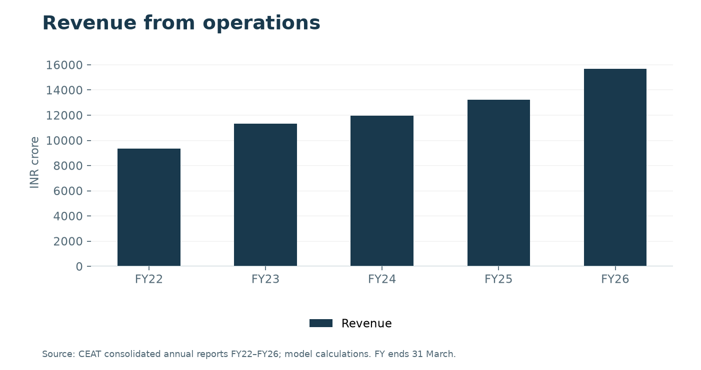
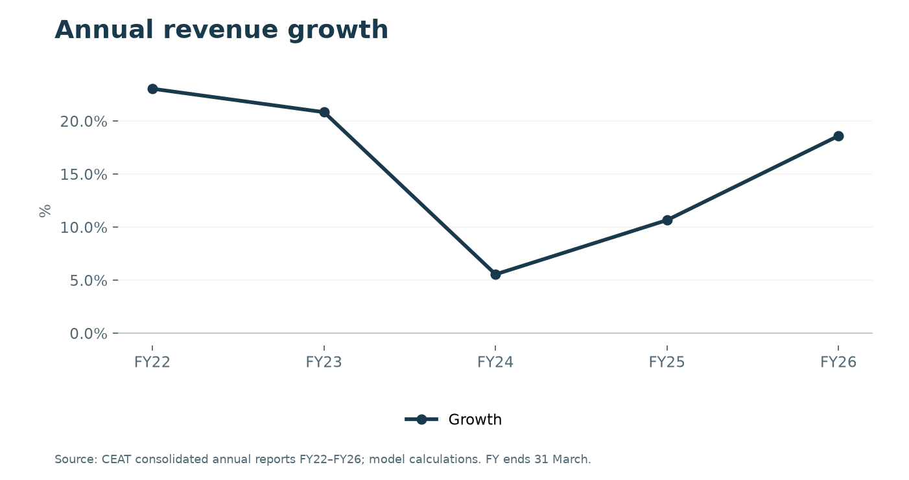
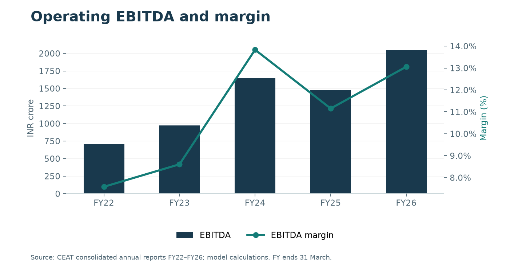
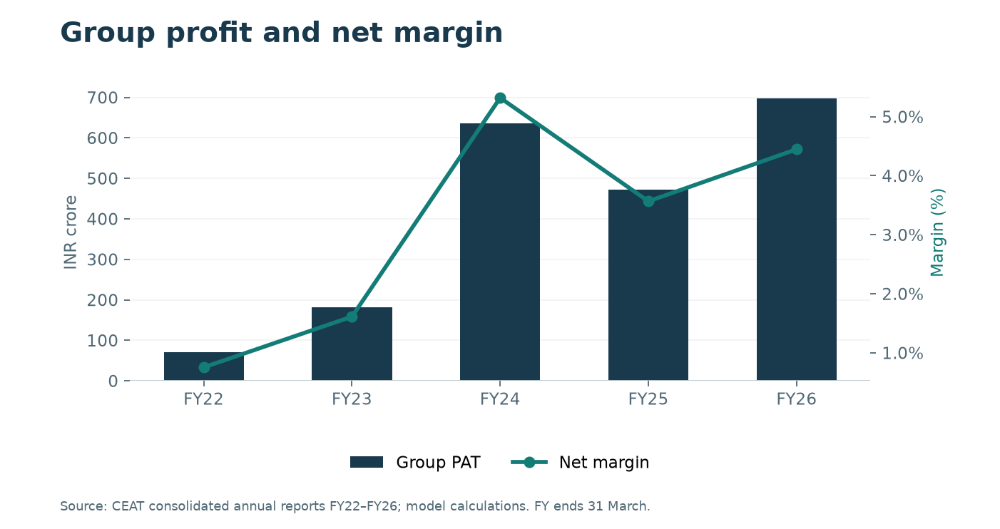
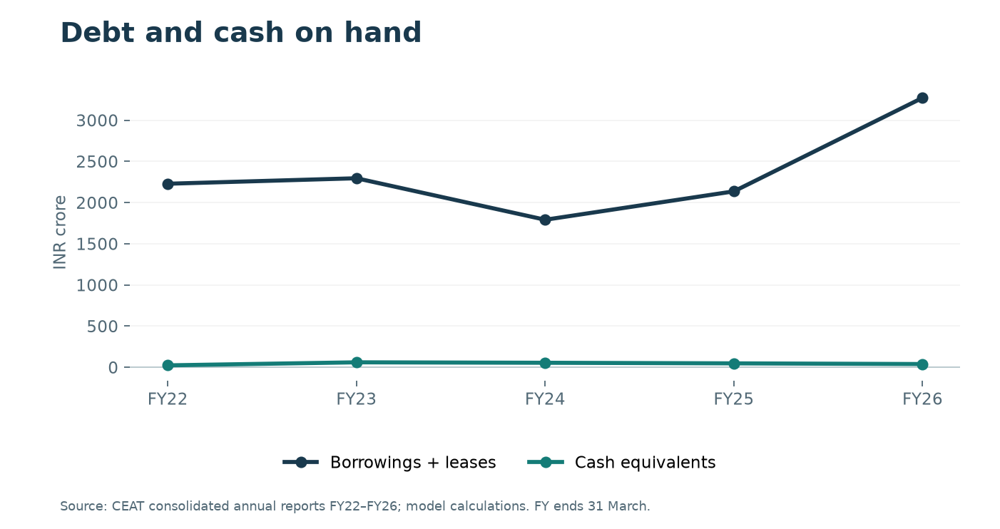
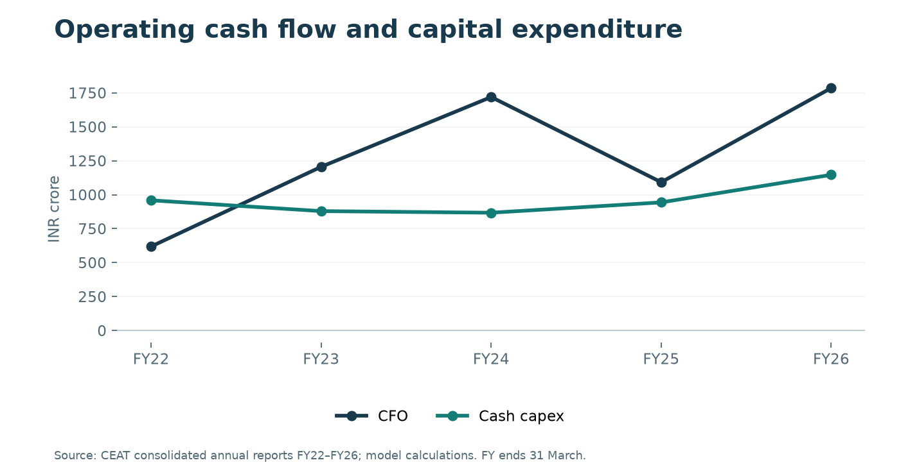
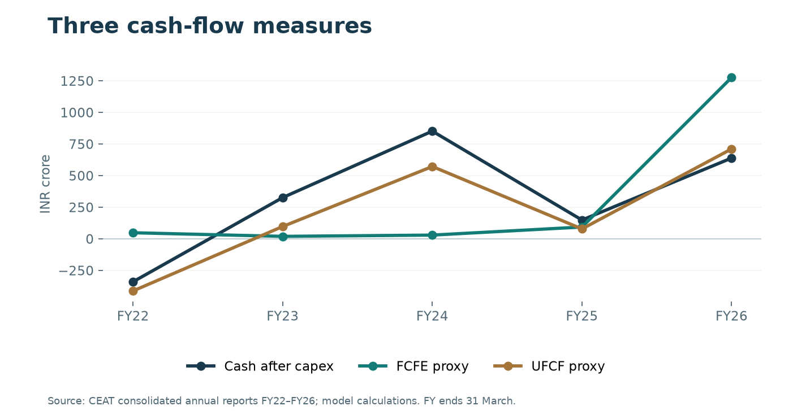
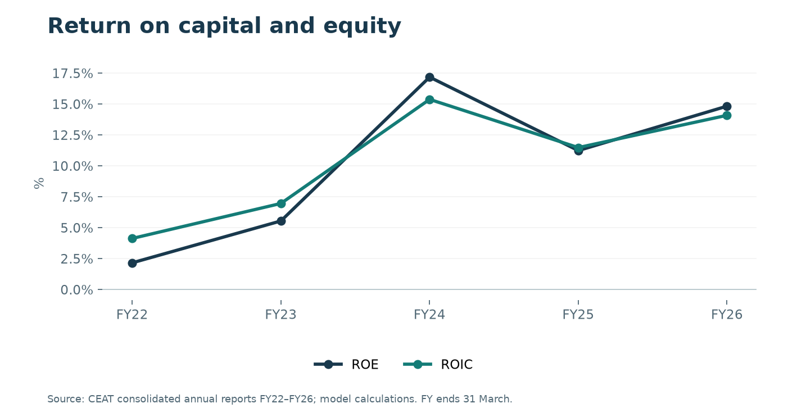

# CEAT Limited — Strategic Advisory, Corporate Valuation & Growth Opportunities

**Investment Banking Pitch Book | Valuation as of 6 November 2026**  
NSE CEATLTD · BSE 500878 · Automobile Components / Tyres and Rubber Manufacturing · India. Financial amounts are consolidated INR crore unless specified. FY26 means 1 April 2025 to 31 March 2026. Per-share values are INR. Independent academic simulation prepared in November 2026.

## 1. Executive summary

**DEFER / RESIZE FUNDING · ₹0cr of ₹300cr self-funded.** Defer the tranche. The proposed term funding is insufficient; resize the program or secure more capital. The on-time schedule first breaches the ₹100cr cash floor in Q3 FY27. Peak bridge borrowing is ₹551cr. The illustrative ₹550cr term issue leaves ₹86cr at the base trough. Under funded stress, the plan needs another ₹1,252cr of peak bridge capacity.

The normalized DCF gives ₹3,324 per share versus the ₹3,545.80 close. It assumes a 15.5% FY31 EBITDA margin, ₹2,346cr of FY31 unlevered free cash flow and 28.6% terminal reinvestment. FY26 peer EV/EBITDA implies ₹2,955–₹3,690. See the dashboard, Funding Decision and Lineage. The model measures quarter-end liquidity from reported September balances. October through 6 November cash movements are unobservable.

## 2. Company background

CEAT began manufacturing in India in 1958 as CEAT Tyres of India Limited and adopted its present name in 1990. Today the RPG Group company sells passenger car and utility vehicle tyres, two- and three-wheeler tyres, truck and bus tyres, light commercial tyres, and off-highway tyres and tracks. Manufacturing and brand-led replacement distribution connect it to end users. OEM relationships create original-fitment volume and a route to subsequent replacement purchases. [AR23](https://www.ceat.com/content/dam/ceat/pdf/Annual_Reports/CEAT-Limited-Integrated-Annual-Report-FY23.pdf) [AR26](https://www.ceat.com/content/dam/ceat/pdf/CEATIntegratedAnnualReport2526Re.pdf) [MIX](https://www.ceat.com/content/dam/ceat/pdf/invpresentation.pdf)

The FY26 accounts include ₹1,120.46 crore of business-combination cash outflow, separate from organic capex. CAMSO added a Sri Lankan manufacturing footprint and off-highway tracks and construction tyres. Management reported less than 50% utilization at the Sri Lankan facility in October. Transitioning upstream equipment and retaining overseas customers are earlier priorities than buying another asset. [AR26](https://www.ceat.com/content/dam/ceat/pdf/CEATIntegratedAnnualReport2526Re.pdf) [CALL](https://www.ceat.com/content/dam/ceat/ceat-revemp/financial-performance/call-transcripts/2026-10-15-ceat-q2fy27-earnings-call-transcript-vF.pdf)

## 3. Business model

**Reported operating profile.** CEAT disclosed 50+ OEM relationships and 61,000+ touchpoints. A touchpoint is broader than a dedicated dealership. The standalone H1 channel split was replacement 50%, OEM 30% and exports 20%. The product split was two/three-wheelers 28%, truck/bus 27%, passenger car/utility vehicles 23%, off-highway 16% and LCV/other 6%. These are two distinct views of the same standalone revenue. Adding the two distributions would double count sales. [MIX](https://www.ceat.com/content/dam/ceat/pdf/invpresentation.pdf)

**Geographic exposure.** FY26 consolidated revenue from contracts with customers was ₹15,479.51 crore, including ₹12,168.44 crore in India and ₹3,311.07 crore outside India (21.4%). FY25 outside-India revenue was ₹2,458.40 crore on ₹13,020.70 crore of contracts. Other operating revenue accounts for the difference to group revenue from operations. Market and product mixes are standalone disclosures, and a consolidated product-profit split was unavailable. [AR26](https://www.ceat.com/content/dam/ceat/pdf/CEATIntegratedAnnualReport2526Re.pdf)

**Capital and control.** The September pattern shows 40,450,092 issued shares. Promoters held 47.29%, the public 52.37% and the employee trust 0.34%. Within public holdings, domestic institutions held 23.26% of the company and foreign institutions 13.41%. The market-cap and valuation denominator uses all listed shares. Excluding 138,229 trust shares would increase per-share value by approximately 0.34%. [SHP](https://www.ceat.com/content/dam/ceat/pdf/shpfinal.pdf)

## 4. Industry analysis

| Evidence | Period and scope | Advisory implication |
|---|---|---|
| Estimated tyre-industry turnover of about ₹1,00,000 crore | ATMA FY25 estimate. Exact first publication day unverified. | Provides scale. Global consolidated issuer sales cannot be divided by this domestic base to infer market shares. |
| Tyre exports rose from ₹25,057 crore to ₹27,312 crore | FY25–FY26, IBEF on 4 Jun 2026 citing ATMA | Export franchises diversify volume, with freight, import barriers and currency movements affecting net realization. |
| Domestic passenger, commercial and two-wheeler sales grew 7.9%, 12.6% and 10.7% | SIAM on 14 Apr 2026. FY26 levels of 46.43 lakh, 10.80 lakh and 2.17 crore vehicles | OEM demand tracks production plans. The installed fleet creates later replacement demand driven by mileage, loading, tyre life and retreading. |
| Seven-company sample revenue rose 15.4% in Q1 FY27 | ICRA, 30 Sep 2026 | Realization increases can lift revenue even as raw material costs erode contribution. |
| Domestic tyre volume demand forecast to grow 5–7% and operating margins to fall about 200 bp | ICRA FY27 outlook, published 30 Sep 2026 | Sector forecast provides a volume anchor. CEAT revenue also reflects price, mix and the acquisition perimeter. |

[ATMA](https://www.atmaindia.org.in/an-overview/) [EXPORT](https://www.ibef.org/news/tyre-exports-reach-record-us-3-09-billion-in-fy26-despite-supply-chain-disruptions) [SIAM](https://www.siam.in/pressrelease-details.aspx?mpgid=48&pgidtrail=50&pid=605) [ICRA](https://www.icra.in/Research/ViewResearchReport/rising-raw-material-costs-to-weigh-on-tyre-industry-profitability-in-fy2027/7142)

Natural rubber drives carcass and tread costs. Synthetic rubber, carbon black and other petrochemical inputs transmit crude-price changes. Inventory residence time and OEM reset schedules can delay price recovery. In Q2 management estimated another 8–9% sequential raw-material cost increase. Replacement channels can reprice quicker, although local competitors and dealer inventory constrain pass-through. A weaker rupee raises import costs and changes the INR value of export receipts. The net hedge depends on currency, procurement timing and contractual terms. [CALL](https://www.ceat.com/content/dam/ceat/ceat-revemp/financial-performance/call-transcripts/2026-10-15-ceat-q2fy27-earnings-call-transcript-vF.pdf) [AR26](https://www.ceat.com/content/dam/ceat/pdf/CEATIntegratedAnnualReport2526Re.pdf)

Infrastructure activity and freight utilization affect commercial replacements and off-highway demand. Plant tooling, curing presses, homologation, channel credit and distribution density raise entry costs. Imports supplied less than 5% of demand in ICRA’s September review despite 22% year-on-year import-volume growth in Q1. GST rationalisation supported demand in the second half of FY26 according to CEAT. Rubber sourcing, waste-tyre producer responsibility and energy efficiency also affect manufacturing economics. A verified domestic concentration ratio and consistent industry-wide utilization rate were unavailable. [ICRA](https://www.icra.in/Research/ViewResearchReport/rising-raw-material-costs-to-weigh-on-tyre-industry-profitability-in-fy2027/7142) [AR26](https://www.ceat.com/content/dam/ceat/pdf/CEATIntegratedAnnualReport2526Re.pdf) [MRFAR](https://www.mrftyres.com/downloads/Annual%20Report%20-%20Final%2013.7.2026.pdf)

## 5. Historical financial performance

| INR crore unless noted | FY22 | FY23 | FY24 | FY25 | FY26 |
| --- | --- | --- | --- | --- | --- |
| Revenue | 9,363 | 11,315 | 11,943 | 13,218 | 15,678 |
| Material cost incl. inventories | 6,028 | 7,385 | 6,924 | 8,232 | 9,502 |
| Employee expense | 694 | 735 | 846 | 856 | 1,071 |
| Other operating expense | 1,932 | 2,220 | 2,521 | 2,655 | 3,057 |
| Operating EBITDA | 710 | 974 | 1,652 | 1,474 | 2,047 |
| D&A | 435 | 469 | 509 | 563 | 697 |
| Operating EBIT | 275 | 504 | 1,143 | 911 | 1,350 |
| Finance cost | 207 | 242 | 269 | 278 | 359 |
| Other income | 11 | 17 | 20 | 18 | 40 |
| JV / associate profit | 29 | 8 | 21 | 22 | 16 |
| Exceptional charges | 13 | 33 | 58 | 30 | 71 |
| PBT incl. JV | 95 | 254 | 857 | 643 | 976 |
| Tax | 24 | 72 | 221 | 172 | 279 |
| Group PAT | 71 | 182 | 635 | 471 | 697 |
| Attributable PAT | 71 | 186 | 643 | 473 | 698 |

**Analyst reconciliation.** Operating EBITDA equals sales less material consumption, purchases, inventory expense, staff cost and other operating expense. Operating EBIT deducts D&A. PBT on the model's comparable basis adds other income and JV earnings and deducts interest and exceptional charges. Group PAT includes minority earnings. P/E and ROE use owner-attributable profit. Management includes JV earnings in its presentation EBITDA, explaining most of the difference between its 13.2% FY26 margin and our 13.1%. Both DCF cash flows and EV multiples exclude equity-accounted earnings, so the equity bridge restores the carrying value of the JV. [AR23](https://www.ceat.com/content/dam/ceat/pdf/Annual_Reports/CEAT-Limited-Integrated-Annual-Report-FY23.pdf) [AR24](https://www.ceat.com/content/dam/ceat/pdf/Annual_Reports/CEAT-Limited-Integrated-Annual-Report-FY24.pdf) [AR26](https://www.ceat.com/content/dam/ceat/pdf/CEATIntegratedAnnualReport2526Re.pdf) [MIX](https://www.ceat.com/content/dam/ceat/pdf/invpresentation.pdf)

| INR crore unless noted | Q2 FY27 | H1 FY27 | H1 FY26 |
| --- | --- | --- | --- |
| Revenue | 4,762 | 9,080 | 7,302 |
| Operating EBITDA | 457 | 822 | 890 |
| D&A | 193 | 379 | 325 |
| EBIT | 264 | 443 | 565 |
| Finance cost | 87 | 233 | 169 |
| Group PAT | 112 | 116 | 297 |
| Attributable PAT | 112 | 116 | 298 |

Q2 reported ₹4,762 crore of sales against ₹3,773 crore a year earlier, while group PAT fell to ₹112 crore from ₹186 crore. H1's lower gross margin and higher finance and depreciation costs reduced parent earnings despite higher volumes and price realizations. October disclosures round amounts to whole crore; the comparative H1 line items can therefore differ from total PAT by ₹1 crore. [H1](https://www.ceat.com/content/dam/ceat/pdf/CEATBMOutcomeOct142026signed.pdf) [MIX](https://www.ceat.com/content/dam/ceat/pdf/invpresentation.pdf) [CALL](https://www.ceat.com/content/dam/ceat/ceat-revemp/financial-performance/call-transcripts/2026-10-15-ceat-q2fy27-earnings-call-transcript-vF.pdf)

| INR crore unless noted | FY22 | FY23 | FY24 | FY25 | FY26 | Sep 26 |
| --- | --- | --- | --- | --- | --- | --- |
| Assets | 9,160 | 9,628 | 9,994 | 11,212 | 13,902 | 15,061 |
| Total equity | 3,296 | 3,457 | 4,052 | 4,376 | 5,054 | 4,969 |
| Current assets incl. held for sale | 2,642 | 2,689 | 2,739 | 3,432 | 4,361 | 5,159 |
| Current liabilities | 3,663 | 4,144 | 4,333 | 5,165 | 6,413 | 7,676 |
| Non-current liabilities | 2,201 | 2,026 | 1,609 | 1,671 | 2,435 | 2,416 |
| Inventory | 1,310 | 1,138 | 1,150 | 1,412 | 1,783 | 2,597 |
| Trade receivables | 1,154 | 1,307 | 1,283 | 1,653 | 1,839 | 1,964 |
| Cash equivalents | 24 | 61 | 55 | 48 | 40 | 32 |
| PPE | 5,017 | 5,716 | 5,927 | 6,569 | 7,631 | 7,779 |
| Borrowings | 2,097 | 2,093 | 1,629 | 1,928 | 3,011 | 3,846 |
| Leases | 132 | 203 | 163 | 208 | 261 | 219 |
| Net debt incl. leases | 2,205 | 2,235 | 1,736 | 2,088 | 3,233 | 4,033 |
| Trade NWC | 306 | 176 | 102 | 325 | 174 | 674 |

Net debt reached ₹4,033 crore at September versus ₹3,233 crore in March. Inventory rose by approximately ₹814 crore in six months. Reported cash was ₹32 crore. A current ratio below 1 reflects heavy trading-credit and short-term funding dependence. Cash alone understates available liquidity when committed lines exist, but undrawn facilities and covenant headroom require lender confirmation. [AR26](https://www.ceat.com/content/dam/ceat/pdf/CEATIntegratedAnnualReport2526Re.pdf) [H1](https://www.ceat.com/content/dam/ceat/pdf/CEATBMOutcomeOct142026signed.pdf)

| INR crore unless noted | FY22 | FY23 | FY24 | FY25 | FY26 | H1 FY27 |
| --- | --- | --- | --- | --- | --- | --- |
| Operating cash flow | 619 | 1,205 | 1,719 | 1,092 | 1,786 | 338 |
| Capex | 959 | 879 | 867 | 943 | 1,147 | 802 |
| Investing cash flow | -944 | -849 | -854 | -922 | -2,271 | -781 |
| Financing cash flow | 313 | -320 | -871 | -177 | 477 | 435 |
| Cash interest paid | 194 | 209 | 267 | 245 | 311 | 178 |
| Lease cash paid | 97 | 94 | 92 | 110 | 134 | 71 |
| Net new borrowings | 679 | -4 | -464 | 299 | 1,082 | 836 |
| WC cash contribution | -74 | 221 | 267 | -291 | -61 | -465 |
| Cash after capex | -340 | 326 | 852 | 149 | 639 | -464 |
| FCFE proxy incl. net borrowing | 48 | 19 | 29 | 93 | 1,276 | 123 |

CFO is the filed operating cash flow. CEAT classifies interest paid in financing. Cash after capex is CFO less cash purchases of PPE/intangibles, including CWIP and capital advances. The FCFE proxy also subtracts financing-classified cash interest and lease payments and adds net new borrowings. It measures debt-supported equity cash flow before acquisitions and shareholder distributions. Historical UFCF is independently reconstructed from operating EBIT, normalized tax, D&A, cash capex and changes in trade NWC. This narrower trade-NWC calculation excludes several operating balances in the statutory cash-flow statement. [AR23](https://www.ceat.com/content/dam/ceat/pdf/Annual_Reports/CEAT-Limited-Integrated-Annual-Report-FY23.pdf) [AR24](https://www.ceat.com/content/dam/ceat/pdf/Annual_Reports/CEAT-Limited-Integrated-Annual-Report-FY24.pdf) [AR26](https://www.ceat.com/content/dam/ceat/pdf/CEATIntegratedAnnualReport2526Re.pdf) [H1](https://www.ceat.com/content/dam/ceat/pdf/CEATBMOutcomeOct142026signed.pdf)

## 6. Financial ratio analysis

| INR crore unless noted | FY22 | FY23 | FY24 | FY25 | FY26 |
| --- | --- | --- | --- | --- | --- |
| Revenue growth | 23.0% | 20.8% | 5.6% | 10.7% | 18.6% |
| EBITDA margin | 7.6% | 8.6% | 13.8% | 11.2% | 13.1% |
| EBIT margin | 2.9% | 4.5% | 9.6% | 6.9% | 8.6% |
| Net margin | 0.8% | 1.6% | 5.3% | 3.6% | 4.4% |
| Current ratio | 0.7x | 0.6x | 0.6x | 0.7x | 0.7x |
| Borrowings / equity | 0.6x | 0.6x | 0.4x | 0.4x | 0.6x |
| ROE | 2.2% | 5.5% | 17.2% | 11.2% | 14.8% |
| ROIC | 4.1% | 7.0% | 15.4% | 11.5% | 14.1% |
| Net debt / EBITDA | 3.1x | 2.3x | 1.1x | 1.4x | 1.6x |
| Capex / sales | 10.2% | 7.8% | 7.3% | 7.1% | 7.3% |
| Historical UFCF proxy | -412 | 98 | 572 | 78 | 711 |

ROE divides parent PAT by the average opening and closing parent equity. ROIC divides normalized after-tax operating EBIT by average invested capital. Invested capital equals group equity plus borrowings and leases, less cash, JV interests and other investments. The first-year averages use March 2021 balances. The FY24 increase in returns followed a recovery in operating margin despite modest sales growth. FY26 ROIC of 14.1% only modestly exceeded the valuation-date WACC of 13.0%; the comparison is indicative because acquisition capital was deployed during the year. Measured FY26 growth includes the CAMSO purchase. [AR22](https://www.ceat.com/content/dam/ceat/pdf/CEAT%20AR%202021-22_Spread-27.6.22.pdf) [AR23](https://www.ceat.com/content/dam/ceat/pdf/Annual_Reports/CEAT-Limited-Integrated-Annual-Report-FY23.pdf) [AR24](https://www.ceat.com/content/dam/ceat/pdf/Annual_Reports/CEAT-Limited-Integrated-Annual-Report-FY24.pdf) [AR26](https://www.ceat.com/content/dam/ceat/pdf/CEATIntegratedAnnualReport2526Re.pdf)

## 7. Competitive landscape

MRF and Apollo each sold roughly twice CEAT's FY26 revenue. Their broader manufacturing footprints and volumes influence procurement scale, product development and fixed-cost absorption. MRF also carries a substantial investment portfolio. Apollo has a European business and FY26 restructuring and tax items. JK Tyre is closest on consolidated revenue and has truck/bus and Mexican exposure. CEAT's two-wheeler and replacement channels offer distribution reach, while CAMSO extends the business into tracks with different customers and utilization risks. Comparing EV/sales without controlling for margins would reward scale independently of cash generation. [MRFAR](https://www.mrftyres.com/downloads/Annual%20Report%20-%20Final%2013.7.2026.pdf) [APFY](https://corporate.apollotyres.com/press-and-media/news/financial/q4-fy26/) [JKH1report](https://dwzytf8fljslz.cloudfront.net/CFS_SEP_2026_a7649b575d.pdf) [AR26](https://www.ceat.com/content/dam/ceat/pdf/CEATIntegratedAnnualReport2526Re.pdf) [MIX](https://www.ceat.com/content/dam/ceat/pdf/invpresentation.pdf)

## 8. Peer selection methodology

| Initial peer | Treatment | Economic reason |
|---|---|---|
| MRF (NSE MRF) | FY26 set | Broad tyres, domestic brand and replacement presence. Larger scale and financial assets require a careful EV bridge. September LTM unavailable by cutoff. |
| Apollo Tyres (NSE APOLLOTYRE) | FY26 and September LTM | Overlapping replacement/OEM lines, with European manufacturing, restructuring charges and a one-off FY26 tax benefit. |
| JK Tyre & Industries (NSE JKTYRE) | FY26 and September LTM | Similar scale, truck/bus exposure and higher leverage. Restated prior-period H1 for the amalgamation. |
| Balkrishna Industries (NSE BALKRISIND) | Specialty reference only | Export-led off-highway economics resemble one CEAT growth business better than CEAT as a whole. |
| TVS Srichakra (NSE TVSSRICHAK) | Product / acquisition screen | Smaller business concentrated in two-wheeler and off-highway tyres, with different customer mix and utilization. |
| Goodyear India (BSE 500168) | Product reference only | Farm tyre exposure and multinational parent relationships limit comparability to the diversified consolidated business. |

Each selected company uses FY26 operating metrics in the primary set. September LTM is a second, two-company cross-check. MRF's June trailing period is excluded from that cross-section. A three-name median can move materially when any single observation changes. [MRF26](https://nsearchives.nseindia.com/corporate/ixbrl/INTEGRATED_FILING_INDAS_156064_07052026183232_iXBRL_WEB.html) [APOLLO26](https://nsearchives.nseindia.com/corporate/ixbrl/INTEGRATED_FILING_INDAS_157532_14052026171627_iXBRL_WEB.html) [JK26](https://nsearchives.nseindia.com/corporate/ixbrl/INTEGRATED_FILING_INDAS_161601_26052026210520_iXBRL_WEB.html) [TVS](https://www.eurogriptyres.com/investor-relations/annual-report)

## 9. Comparable company valuation

| Company | NSE close ₹ | Shares cr | Mkt cap | Debt incl leases | NCI | Cash + deposits | Investments | EV |
| --- | --- | --- | --- | --- | --- | --- | --- | --- |
| MRF | 125,295.00 | 0.4241143 | 53,139.4 | 3,206.7 | 0.2 | 2,171.6 | 3,397.8 | 50,776.8 |
| APOLLOTYRE | 415.95 | 63.5100946 | 26,417.0 | 5,513.1 | 0.0 | 973.3 | 56.8 | 30,900.0 |
| JKTYRE | 359.25 | 28.8289511 | 10,356.8 | 6,124.6 | -0.7 | 156.9 | 119.2 | 16,204.7 |
| CEATLTD | 3,545.80 | 4.0450092 | 14,342.8 | 4,065.0 | 8.0 | 32.0 | 195.0 | 18,188.8 |

EV = listed equity capitalization + borrowings + lease obligations + reported NCI − cash equivalents − eligible deposits − identified non-operating investments. Book values proxy claim and investment fair values. MRF uses the March balance sheet; other bridges use September. MRF includes ₹1,867.02 crore of 3–12 month deposits and excludes unclaimed dividends and restricted CSR balances. For the other issuers, bank accounts outside cash equivalents are retained where availability could not be established. JK Tyre's reported negative NCI is carried at book value. Enterprise values are calculated on 6 November; balance-sheet dates are proxies for the valuation date. [MRFAR](https://www.mrftyres.com/downloads/Annual%20Report%20-%20Final%2013.7.2026.pdf) [APOLLOH127](https://nsearchives.nseindia.com/corporate/ixbrl/INTEGRATED_FILING_INDAS_209419_04112026164438_iXBRL_WEB.html) [JKH1report](https://dwzytf8fljslz.cloudfront.net/CFS_SEP_2026_a7649b575d.pdf) [H1](https://www.ceat.com/content/dam/ceat/pdf/CEATBMOutcomeOct142026signed.pdf) [NSE 2026-11-06](https://nsearchives.nseindia.com/products/content/sec_bhavdata_full_06112026.csv)

| Company / period | Revenue | EBITDA | EBIT | Parent PAT | EV/sales | EV/EBITDA | EV/EBIT | P/E |
| --- | --- | --- | --- | --- | --- | --- | --- | --- |
| MRF · FY26 | 31,149 | 4,901 | 3,147 | 2,426 | 1.6x | 10.4x | 16.1x | 21.9x |
| APOLLOTYRE · FY26 | 28,471 | 4,143 | 2,600 | 1,372 | 1.1x | 7.5x | 11.9x | 19.2x |
| JKTYRE · FY26 | 16,327 | 2,031 | 1,559 | 776 | 1.0x | 8.0x | 10.4x | 13.3x |
| CEATLTD · FY26 | 15,678 | 2,047 | 1,350 | 698 | 1.2x | 8.9x | 13.5x | 20.5x |
| APOLLOTYRE · Sep LTM | 30,445 | 3,978 | 2,425 | 1,743 | 1.0x | 7.8x | 12.7x | 15.2x |
| JKTYRE · Sep LTM | 17,233 | 1,700 | 1,204 | 495 | 0.9x | 9.5x | 13.5x | 20.9x |
| CEATLTD · Sep LTM | 17,456 | 1,979 | 1,228 | 516 | 1.0x | 9.2x | 14.8x | 27.8x |

MRF’s separately dated June LTM revenue was ₹31,889 crore and operating EBITDA was ₹4,821 crore. Its June LTM EV/EBITDA was 10.5x. It carries zero weight in the September LTM statistics. [MRFJune](https://nsearchives.nseindia.com/corporate/MRF_11082026122306_RESULTAUGUST.pdf) [MRFAR](https://www.mrftyres.com/downloads/Annual%20Report%20-%20Final%2013.7.2026.pdf)

LTM = audited FY26 + H1 FY27 − H1 FY26, using like-for-like consolidated earnings. Operating EBITDA for the peers equals pre-exceptional profit before equity-accounted earnings and tax, less other income, plus gross finance cost and D&A. P/E uses net profit attributable to owners, retaining tax and exceptional effects. MRF's primary annual report resolves an unpopulated ownership-attribution field in the exchange table. Its parent PAT differs from consolidated profit by less than ₹0.02 crore. [MRFAR](https://www.mrftyres.com/downloads/Annual%20Report%20-%20Final%2013.7.2026.pdf) [APOLLO26](https://nsearchives.nseindia.com/corporate/ixbrl/INTEGRATED_FILING_INDAS_157532_14052026171627_iXBRL_WEB.html) [APOLLOH126](https://nsearchives.nseindia.com/corporate/ixbrl/INTEGRATED_FILING_INDAS_127406_13112025184923_iXBRL_WEB.html) [APOLLOH127](https://nsearchives.nseindia.com/corporate/ixbrl/INTEGRATED_FILING_INDAS_209419_04112026164438_iXBRL_WEB.html) [JKFYreport](https://dwzytf8fljslz.cloudfront.net/CFS_Mar_2026_101522c61b.pdf) [JKH1report](https://dwzytf8fljslz.cloudfront.net/CFS_SEP_2026_a7649b575d.pdf)

| FY26 sample | EV/sales | EV/EBITDA | EV/EBIT | P/E |
| --- | --- | --- | --- | --- |
| Minimum | 1.0x | 7.5x | 10.4x | 13.3x |
| 25th percentile | 1.0x | 7.7x | 11.1x | 16.3x |
| Median | 1.1x | 8.0x | 11.9x | 19.2x |
| Mean | 1.2x | 8.6x | 12.8x | 18.2x |
| 75th percentile | 1.4x | 9.2x | 14.0x | 20.6x |
| Maximum | 1.6x | 10.4x | 16.1x | 21.9x |

Applying the median EV/EBITDA multiple of 8.0x to CEAT operating EBITDA of ₹2,047 crore produces ₹16,331 crore of enterprise value. Subtracting the ₹3,846 crore net bridge yields ₹12,485 crore of equity, or ₹3,087 per listed share. CEAT's own FY26 EV/EBITDA is 11.4% above the peer median. Depreciation makes the EBIT method more sensitive to the age of assets and acquisition amortization. P/E incorporates differences in financing, taxes and exceptional charges. The same-method September LTM median is ₹3,282 per share with two peers.

Excluding MRF, Apollo or JK in turn gives ₹2,955, ₹3,690 or ₹3,558 per CEAT share. The wide dispersion supports using the median and publishing the interval. Comparable EBITDA removes other income from pre-exceptional PBT plus finance costs and depreciation. JK's ₹2,089cr PBDIT falls to ₹2,031cr. Compare closing-asset operating returns, margin, business mix and leverage in Peer Diagnostics.

## 10. DCF valuation

The normalized DCF gives ₹3,324 per share versus the ₹3,545.80 close. It assumes a 15.5% FY31 EBITDA margin, ₹2,346cr of FY31 unlevered free cash flow and 28.6% terminal reinvestment. Explicit PV is ₹4,411cr; continuing PV is ₹12,880cr. Apply 13.0% WACC to dated quarters. Allocate the December quarter evenly over 92 days and retain the days after 6 November. Terminal FY32 NOPAT of ₹2,782cr supports 4.0% growth with 14.0% incremental ROIC. Deduct ₹795cr reinvestment to obtain ₹1,987cr continuing UFCF. Deduct September claims of ₹3,846cr. FY29 trademark and replacement lease investment appear in operating valuation cash flow once.

The reference DCF gives ₹1,370. Reaching the close with its explicit flows fixed requires ₹2,343cr of FY31-equivalent UFCF versus ₹1,037cr modeled. At fixed sales, D&A, capex and working capital that implies a 19.6% EBITDA margin against its 12.5% base. The reverse test changes the terminal run rate only. The reference FY31 model had sales of ₹24,649cr, a 12.5% EBITDA margin and cash capex of ₹1,479cr. The quarterly underwriting instead reaches ₹29,108cr sales, 15.5% margin and ₹1,060cr cash investment. The resulting ₹2,346cr FY31 UFCF falls to ₹1,987cr in the normalized terminal year as reinvestment catches up. Moving to the new forecast changes explicit PV by ₹498 per share and continuing PV by ₹1,456 per share. Unit growth, price recovery, favorable mix and fixed-cost absorption expand margin; FY31 regular cash investment of ₹1,060cr is materially below the reference forecast. These are consequential underwriting judgments.

On the revised sales and reinvestment path, a 64 bp margin uplift phased through FY31 produces a 16.2% FY31 EBITDA margin, ₹2,485cr of FY31 UFCF and ₹3,546 per share. FY32 reinvestment rises to ₹836cr.

## 11. WACC methodology

Weekly stock beta is 1.39 on 52 raw price returns versus NIFTYBEES. The July India ERP is 6.9%; subtract the July sovereign spread from the 6 November CCIL benchmark to get 5.4% risk-free. Use market equity and gross financial debt including leases. Pretax debt cost is the top of the FY26 domestic loan range. Peer Diagnostics un-levers each peer beta at its gross debt / spot equity with a common normalized tax rate, takes the median 0.98, and re-levers to CEAT at 1.19. The resulting 11.9% WACC gives ₹3,950. Retain stock beta for the central case because it directly observes CEAT's listed risk. Geographic mix, short sample and limited peer count weaken both estimates.

## 12. Sensitivity and scenario analysis

| Normalized sensitivity | WACC | Growth | Incremental ROIC | ₹ / share |
| --- | --- | --- | --- | --- |
| Base | 13.0% | 4.0% | 14.0% | ₹3,324 |
| Peer beta | 11.9% | 4.0% | 14.0% | ₹3,950 |
| WACC −100 bp | 12.0% | 4.0% | 14.0% | ₹3,892 |
| WACC +100 bp | 14.0% | 4.0% | 14.0% | ₹2,870 |
| Growth −50 bp | 13.0% | 3.5% | 14.0% | ₹3,292 |
| Growth +50 bp | 13.0% | 4.5% | 14.0% | ₹3,358 |
| ROIC −300 bp | 13.0% | 4.0% | 11.0% | ₹2,976 |
| ROIC +300 bp | 13.0% | 4.0% | 17.0% | ₹3,548 |

Each line changes one input and recomputes both the explicit and continuing PV. Growth changes required terminal reinvestment. The original two-dimensional grids remain in the reference model.

| Case | First gap¹ | Peak bridge | Peak loans² | Cash pre-bridge | Funded low | Affordable |
| --- | --- | --- | --- | --- | --- | --- |
| On time | Q3 FY27 | ₹551cr | ₹4,237cr | −₹444cr | ₹100cr | ₹0cr |
| Delay | Q3 FY27 | ₹248cr | ₹3,960cr | −₹144cr | ₹100cr | ₹0cr |
| External | Q4 FY27 | ₹14cr | ₹4,316cr | ₹86cr | ₹100cr | ₹286cr |
| Stress | Q3 FY27 | ₹1,792cr | ₹4,915cr | −₹1,572cr | ₹100cr | ₹0cr |
| Funded stress | Q4 FY27 | ₹1,252cr | ₹4,925cr | −₹1,084cr | ₹100cr | ₹0cr |

¹ First quarter below floor after planned financing, before a balancing draw. ² Gross borrowings exclude leases. Negative pre-bridge cash measures an unfunded requirement. Funded cash assumes the bridge is available. Stress adds an eight-point commodity step, lowers recovery to 40% and assumes 10% nonrenewal of residual debt. No additional borrowing capacity is evidenced.

## 13. Valuation synthesis

The normalized DCF gives ₹3,324 per share versus the ₹3,545.80 close. It assumes a 15.5% FY31 EBITDA margin, ₹2,346cr of FY31 unlevered free cash flow and 28.6% terminal reinvestment. FY26 three-peer interquartile band is ₹2,955–₹3,690. The FY26 median of 8.0x produces ₹3,087. Use this as an independent relative mark given the two-peer September LTM sample and CEAT-specific margin recovery. The two methods should remain separately interpretable.

## 14. Strategic alternatives

**A · Staged organic expansion.** Complete already-committed Nagpur two-wheeler and Chennai truck/bus and passenger radial investments. Management reported roughly ₹120 crore-plus of quarterly spending at Nagpur and about ₹280 crore at Chennai. Allocate further tooling to confirmed OEM nominations and replacement cohorts with positive incremental contribution. Test realized contribution, yields and receivable days before approving subsequent tranches. The upside is throughput on an existing channel; the risk is inventory accumulation before pricing recovers. [CALL](https://www.ceat.com/content/dam/ceat/ceat-revemp/financial-performance/call-transcripts/2026-10-15-ceat-q2fy27-earnings-call-transcript-vF.pdf) [MIX](https://www.ceat.com/content/dam/ceat/pdf/invpresentation.pdf)

**B · Hypothetical acquisition screens.** TVS Srichakra's two-wheeler and off-highway capacity offers product fit, but overlaps CEAT's organic investments. Its FY26 annual report describes ₹220 crore of additional approved capacity spend at Madurai. Test whether an alliance, plant-level agreement or asset acquisition could access a distinctive product or customer more cheaply than enterprise control. Indag Rubber's pre-cured tread and retreading materials offer a different route to fleet lifecycle service. Diligence should test casing quality, warranty risk, repeat fleet revenue, maintenance capex, customer concentration and promoter willingness. Public disclosures establish business fit alone. Buyer interest, seller availability, control premiums, deal values and synergies are unverified. Debt-financed control is difficult to support while H1 cash after capex is negative. A minority investment or milestone-based consideration could limit initial funding, subject to diligence and negotiated rights. [TVS](https://www.eurogriptyres.com/investor-relations/annual-report) [INDAG](https://indagrubber.com/investors/annual-reports-other-reports) [H1](https://www.ceat.com/content/dam/ceat/pdf/CEATBMOutcomeOct142026signed.pdf)

**C · Financing alternatives.** An illustrative ₹1,000 crore program equals 7.0% of CEAT's spot equity value. At 7.8%, all-debt funding adds ₹78 crore of annual pretax interest and about ₹58 crore after normalized tax. Gross debt rises from ₹4,065 crore to ₹5,065 crore before repayment. Issuing equity at the ₹3,545.80 reference price would create 0.282 crore shares and 6.5% post-issue dilution before fees and discounts. Internal funding preserves ownership but temporarily demands working-capital release or deferred capex. A convertible can defer cash interest or equity issuance in return for option value, covenants and potential dilution. Pricing and feasibility require lender or investor terms.

**D · Partnership / JV.** Pilot an overseas distributor for CAMSO tracks using minimum offtake, service obligations and capped support for inventory. A manufacturing or technology JV can share tooling and local homologation, but exclusivity, intellectual-property rights and channel conflict need contractual limits. Measure partner sell-through and warranty claims before expanding territory. CEAT already accounts for Sri Lankan joint ventures, providing experience with shared governance. [AR26](https://www.ceat.com/content/dam/ceat/pdf/CEATIntegratedAnnualReport2526Re.pdf) [CALL](https://www.ceat.com/content/dam/ceat/ceat-revemp/financial-performance/call-transcripts/2026-10-15-ceat-q2fy27-earnings-call-transcript-vF.pdf)

**E · Strategic merger or sale.** A buyer could spread R&D and distribution expense over a larger base or use CEAT's Indian network. Industrial logic alone does not establish a control premium. Promoter consent, customer retention, competition review, pricing of minority interests and governance would drive executable value. Set the standalone DCF and trading benchmarks before discussing any potential offer. No buyer, mandate or negotiations are assumed.

## 15. Recommended strategic direction

Defer the tranche. The proposed term funding is insufficient; resize the program or secure more capital. The on-time schedule first breaches the ₹100cr cash floor in Q3 FY27. Peak bridge borrowing is ₹551cr. The illustrative ₹550cr term issue leaves ₹86cr at the base trough. Under funded stress, the plan needs another ₹1,252cr of peak bridge capacity. Delaying the two payments by four quarters reduces peak bridge need to ₹248cr. The core plan itself still breaches the floor. Before signing equipment orders require documented term availability, monthly cash forecasts clearing ₹100cr, and downside coverage. If either fails, hold the discretionary spend. Re-underwrite if the Q3 basket exceeds the 3–3.5% management outlook or collection/inventory days exceed the modeled path. These are analyst approval gates.

Management guided to ₹1,400cr standalone plus ₹100–150cr upstream CAMSO equipment. Midpoint group planning envelope ₹1,525cr includes ₹802cr already spent. The proposed tranche is incremental. March capital contracts outstanding were ₹1,785.12cr net of advances. September committed-scope phasing is an analyst estimate. Inventory commitment of about US$44m is included through turnover; any unpaid lump sum above modeled inventory would require additional funding. The separate US$44m trademark is scheduled in Q2 FY29.

| On-time, ₹ crore | FY27E | FY28E | FY29E | FY30E | FY31E |
| --- | --- | --- | --- | --- | --- |
| Sales | 19,392 | 22,242 | 24,328 | 26,611 | 29,108 |
| Operating EBITDA | 2,039 | 2,897 | 3,377 | 3,914 | 4,516 |
| Group PAT | 599 | 1,279 | 1,636 | 2,039 | 2,488 |
| Operating cash | 1,268 | 2,330 | 2,735 | 3,128 | 3,569 |
| Investing cash | -1,804 | -1,060 | -1,456 | -1,060 | -1,060 |
| Financing cash | 596 | -1,270 | -1,155 | -638 | -863 |
| Closing cash | 100 | 100 | 224 | 1,653 | 3,299 |
| Borrowings | 4,237 | 3,578 | 2,975 | 2,844 | 2,472 |
| Equity | 5,452 | 6,591 | 8,087 | 9,986 | 12,333 |

## 16. Transaction and execution risks

| Risk | Early indicator | Proposed response |
|---|---|---|
| Rubber and crude costs outrun pricing | Contribution per kg, inventory carrying cost, OEM reset lag | Reset contract prices where possible and limit speculative inventory. |
| Volume or utilization disappoints | Orders versus rated capacity, dealer sell-through, CAMSO uptime | Stage tooling and use pilot agreements before capacity commitments. |
| Foreign exchange or export restrictions | Unhedged procurement and collections by currency, cross-border lead times | Match funding and purchase currency; model landed cost by market. |
| Debt service and refinancing | Short maturities, quarterly cash after capex, floating-rate reset | Pre-agree liquidity and test headroom before any binding acquisition. |
| Integration or product quality | First-pass yield, returns, technical approvals and warranty claims | Assign technical owners and escalate failures before volume ramps. |
| Valuation and control | WACC–g spread, implied terminal UFCF, synergies after integration cost | Test downside financing and independent standalone valuation before any premium. |

## 17. Limitations

There is one reportable group segment. CAMSO contributed ₹420.65cr of FY26 product sales after acquisition. Subtracting this from group operating revenue gives ₹15,257.35cr and a directional 15.4% growth proxy against FY25, compared with 18.6% reported. Product sales and total operating revenue have different perimeters. H1 disclosed end-customer billing and transition counts cannot establish audited consolidated CAMSO sales or margins. The core unit index, relative OHT realization, capacity, pass-through and CAMSO realization factor are assumptions. Forecast material cost uses a composite basket; rubber-specific spend is unavailable.

Quarter-end observations can miss intraperiod stress. Contract phasing, lender headroom, security packages, refinancing terms, plant-level returns and a project-specific sales ramp are unverified. Existing short funding is assumed renewed except in stress. Forecast other assets/liabilities are held constant. A common margin shock increases EBITDA without fresh explicit capacity and maintains the terminal incremental ROIC; it is a market-implied diagnostic. Legacy DCF and sensitivities are retained for comparison. The annual statements contain rounded interim balances.

Independent public-information portfolio analysis. Source archive, publication dates, conversions and primary-page checks and derived component ties are in the input register.

## 18. References

The source register includes original URLs, financial periods, filing dates or availability evidence, retrieval date, and audit notes. The archived NSE panel includes an original file link for each observation. Cash-market prices use CLOSE_PRICE, EQ series. Excel sheet and row labels match the calculation tables in this memo.

- **AR22** · CEAT · 2022 (exact dispatch day unverified) · Consolidated statements; PDF pages 114. [Integrated annual report FY22](https://www.ceat.com/content/dam/ceat/pdf/CEAT%20AR%202021-22_Spread-27.6.22.pdf)
- **AR23** · CEAT · 2023 (exact dispatch day unverified) · Consolidated statements; PDF pages 126–127. [Integrated annual report FY23](https://www.ceat.com/content/dam/ceat/pdf/Annual_Reports/CEAT-Limited-Integrated-Annual-Report-FY23.pdf)
- **AR24** · CEAT · 2024 (exact dispatch day unverified) · Consolidated statements; PDF pages 122–123. [Integrated annual report FY24](https://www.ceat.com/content/dam/ceat/pdf/Annual_Reports/CEAT-Limited-Integrated-Annual-Report-FY24.pdf)
- **AR26** · CEAT · 2026-07-23 · Consolidated statements; PDF pages 138–139, notes 17, 20, 28 and geographical disclosures. [Integrated annual report FY26](https://www.ceat.com/content/dam/ceat/pdf/CEATIntegratedAnnualReport2526Re.pdf)
- **H1** · CEAT · 2026-10-14 · Consolidated statements, PDF pp16–18. [October board outcome](https://www.ceat.com/content/dam/ceat/pdf/CEATBMOutcomeOct142026signed.pdf)
- **MIX** · CEAT · 2026-10-14 · Group performance; standalone shares on p7. [Q2 investor presentation](https://www.ceat.com/content/dam/ceat/pdf/invpresentation.pdf)
- **CALL** · CEAT · 2026-10-15 (call date) · Management commentary on costs, capacity, CAMSO and capex. [Q2 earnings call](https://www.ceat.com/content/dam/ceat/ceat-revemp/financial-performance/call-transcripts/2026-10-15-ceat-q2fy27-earnings-call-transcript-vF.pdf)
- **SHP** · CEAT · October quarter filing; issuer PDF generated 2026-11-03 · Table I: issued shares, promoter, public and employee trust. [Shareholding pattern](https://www.ceat.com/content/dam/ceat/pdf/shpfinal.pdf)
- **JK26** · Issuer via NSE · 2026-05-26 · Income, balance sheet; displayed lakhs divided by 100. [Consolidated Ind AS integrated filing](https://nsearchives.nseindia.com/corporate/ixbrl/INTEGRATED_FILING_INDAS_161601_26052026210520_iXBRL_WEB.html)
- **MRF26** · Issuer via NSE · 2026-05-07 · Income, balance sheet; displayed lakhs divided by 100. [Consolidated Ind AS integrated filing](https://nsearchives.nseindia.com/corporate/ixbrl/INTEGRATED_FILING_INDAS_156064_07052026183232_iXBRL_WEB.html)
- **APOLLO26** · Issuer via NSE · 2026-05-14 · Income, balance sheet; displayed lakhs divided by 100. [Consolidated Ind AS integrated filing](https://nsearchives.nseindia.com/corporate/ixbrl/INTEGRATED_FILING_INDAS_157532_14052026171627_iXBRL_WEB.html)
- **APOLLOH127** · Issuer via NSE · 2026-11-04 · Income, balance sheet; displayed lakhs divided by 100. [Consolidated Ind AS integrated filing](https://nsearchives.nseindia.com/corporate/ixbrl/INTEGRATED_FILING_INDAS_209419_04112026164438_iXBRL_WEB.html)
- **JKH127** · Issuer via NSE · 2026-10-23 · Income, balance sheet; displayed lakhs divided by 100. [Consolidated Ind AS integrated filing](https://nsearchives.nseindia.com/corporate/ixbrl/INTEGRATED_FILING_INDAS_203720_23102026201519_iXBRL_WEB.html)
- **APOLLOH126** · Issuer via NSE · 2025-11-13 · Income, balance sheet; displayed lakhs divided by 100. [Consolidated Ind AS integrated filing](https://nsearchives.nseindia.com/corporate/ixbrl/INTEGRATED_FILING_INDAS_127406_13112025184923_iXBRL_WEB.html)
- **JKH1report** · JK Tyre · 2026-10-23 · pp4,6 restated H1 comparable and leases. [Interim consolidated statements](https://dwzytf8fljslz.cloudfront.net/CFS_SEP_2026_a7649b575d.pdf)
- **JKFYreport** · JK Tyre · 2026-05-26 · p7 restated FY25 comparative. [Annual consolidated results](https://dwzytf8fljslz.cloudfront.net/CFS_Mar_2026_101522c61b.pdf)
- **JKSH** · JK Tyre · 2026-10-21 (document date) · 28,82,89,511 issued shares. [September ownership](https://dwzytf8fljslz.cloudfront.net/SH_Pwebsite_bfd9688559.pdf)
- **APSH** · Apollo Tyres · 2026-10-21 · 635,100,946 issued shares. [September ownership](https://corporate.apollotyres.com/content/dam/orbit/apollo-corporate/investors/shareholding-information/shareholding-pattern/2026-27/Shareholding%20Pattern%20-%20September%2030,%202026.pdf)
- **APFY** · Apollo Tyres · 2026-05-14 · FY25 comparator and FY26 special items. [Full-year results](https://corporate.apollotyres.com/press-and-media/news/financial/q4-fy26/)
- **MRFAR** · MRF · July 2026 · Consolidated pp145–146 printed; shares, leases, liquid deposits and parent earnings. [Annual report 2025–26](https://www.mrftyres.com/downloads/Annual%20Report%20-%20Final%2013.7.2026.pdf)
- **YIELD** · CCIL · 2026-11-06 · 6.94% GS 2036, 9–10Y bucket, 7.1816%. [Tenor-wise indicative yields](https://dr.ccilindia.com/web/ccil/tenorwise-indicative-yields)
- **ERP** · Aswath Damodaran, NYU · 2026-07-15 (release article) · India row 73 D/E, rating-based default spread and total ERP. [Country risk premium spreadsheet, July edition](https://pages.stern.nyu.edu/~adamodar/pc/datasets/ctrypremJuly26.xlsx)
- **SIAM** · SIAM · 2026-04-14 · FY26 wholesale volume and growth. [FY26 automobile industry performance](https://www.siam.in/pressrelease-details.aspx?mpgid=48&pgidtrail=50&pid=605)
- **ICRA** · ICRA · 2026-09-30 · Q1 sample growth; FY27 domestic demand and margin forecast. [Rising raw material costs to weigh on tyre industry profitability](https://www.icra.in/Research/ViewResearchReport/rising-raw-material-costs-to-weigh-on-tyre-industry-profitability-in-fy2027/7142)
- **EXPORT** · India Brand Equity Foundation · 2026-06-04 · FY25 and FY26 export values; ATMA data. [Tyre exports reach record US$3.09bn](https://www.ibef.org/news/tyre-exports-reach-record-us-3-09-billion-in-fy26-despite-supply-chain-disruptions)
- **MRFJune** · MRF via NSE · 2026-08-11 · p8; separate June LTM cross-check. [June consolidated interim results](https://nsearchives.nseindia.com/corporate/MRF_11082026122306_RESULTAUGUST.pdf)
- **ATMA** · ATMA · Exact day unavailable; overview also in Kochi press release indexed by Oct 2026 · Industry turnover around INR 100,000 crore; estimated, not audited. [Indian tyre industry overview](https://www.atmaindia.org.in/an-overview/)
- **TVS** · TVS Srichakra · September 2026 · Two-wheeler and off-highway capacities and Madurai expansion. [Annual report 2025–26](https://www.eurogriptyres.com/investor-relations/annual-report)
- **INDAG** · Indag Rubber · July 2026 · Pre-cured tread, bonding materials and retreading. [Annual report 2025–26](https://indagrubber.com/investors/annual-reports-other-reports)
- **NSE 2026-11-06** · NSE · 2026-11-06 · EQ CLOSE_PRICE; weekly price panel and valuation cross-section. [Daily cash-market security-wise delivery and price file](https://nsearchives.nseindia.com/products/content/sec_bhavdata_full_06112026.csv)

### Supporting figures

